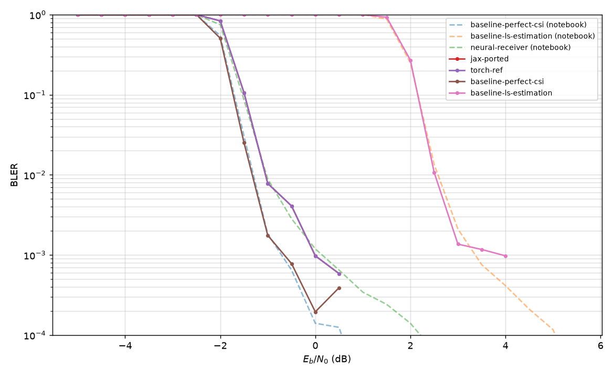

# nrx-jax

Sionna's 5G neural receiver (NRX), ported from PyTorch to JAX/Flax, verified against the original, and
benchmarked across XLA backends.

**Why.** Nvidia runs neural receivers with TensorRT, which only targets Nvidia GPUs. A JAX version compiles through
XLA, so the same receiver can run on GPU, TPU, or any accelerator with a PJRT plugin. This repo is the verified
starting point for measuring whether neural PHY models can meet 5G slot deadlines (0.5 ms at 30 kHz SCS) outside
Nvidia's stack. Holding the model, weights and channel fixed means the compiler stack is the only thing that changes.

| | |
|---|---|
| Model | Sionna tutorial NRX: SIMO uplink, 4 residual conv blocks, per-element LayerNorm, 4.86 M params |
| Channel | 3GPP 38.901 CDL-C, 3.5 GHz, 30 kHz SCS, 128 subcarriers × 14 symbols, QPSK, LDPC rate 1/2 |
| Reference | [`tutorials/phy/Neural_Receiver.ipynb`](https://github.com/NVlabs/sionna/blob/main/tutorials/phy/Neural_Receiver.ipynb), Sionna 2.2.0 |

Details: [PLAN.md](PLAN.md) (spec) · [STEPS.md](STEPS.md) (checklist and status).

---

## Results so far

**1. The port matches PyTorch.** With Sionna's pre-trained weights loaded, JAX and torch LLRs agree to
**4.96e-5** (max |LLR| ≈ 43). Both are ~3e-5 from an fp64 reference.

**2. The port matches the published error rate.** A reduced Monte-Carlo sweep (5,120 blocks per point) gives
the same BLER for the JAX and torch receivers, and both sit within 0.15 dB of the notebook:

| BLER | notebook NRX | JAX port |
|---|---|---|
| 1e-1 | −1.53 dB | −1.49 dB |
| 1e-2 | −1.03 dB | −1.05 dB |
| 1e-3 | +0.14 dB | −0.01 dB |



**Full sweep (Colab L4, notebook settings).** JAX and torch are again identical. At BLER 1e-2 / 1e-3 / 1e-4 the
port sits at −1.03 / 0.21 / 2.33 dB against the notebook's −1.03 / 0.14 / 2.21 dB, a gap of 0.00 / 0.07 / 0.12 dB.
At 1e-4 each point rests on ~13 block errors, so that last number carries roughly ±0.15 dB of Monte-Carlo noise.
See `results/ber_bler_ported.{csv,png}`.

**3. The same code runs on more than one backend.** Apple M4 Pro, B = 1 (one user per slot):

| Backend | p50 | p99 | max \|ΔLLR\| vs torch |
|---|---|---|---|
| XLA:CPU (jax 0.12.1) | 3.04 ms | 3.17 ms | 4.96e-5 |
| Metal GPU via `jax-metal` PJRT plugin (jax 0.4.34) | 1.25 ms | 1.34 ms | 3.72e-5 |
| XLA:GPU on NVIDIA L4 (jax 0.12.1, CUDA 13) | 0.78 ms | 0.90 ms | 6.2e-3 (TF32) |

The model costs 4.05 GFLOP per user per slot, so meeting 0.5 ms at B = 1 needs ≥ 8.1 TFLOP/s sustained.
The L4 runs its convolutions in TF32 by default (10-bit mantissa), hence the larger LLR error. True-fp32 and
TensorRT numbers on the same GPU come next.

**4. A look inside the compiler (XLA:CPU, B = 1).** 186 jaxpr equations become 305 StableHLO ops and then
62 kernels. Convs take ~75% of the time and LayerNorm ~20%. Each LayerNorm becomes 5 kernels, and the conv bias add
isn't fused into the conv. See [results/compiler_cpu_b1.md](results/compiler_cpu_b1.md).

### Finding: the pilots are part of the model
Sionna 2.x draws the Kronecker pilot symbols from the active device's torch RNG when the resource grid is built.
The tutorial weights were trained on CUDA with seed 42, and the pilots are **not** stored in the checkpoint.
On any other device the pilots differ, and the pre-trained receiver fails completely (uncoded BER ≈ 0.44). The
network-level parity test can't catch this, because both models get the same wrong pilots.

[`nrx/pilots.py`](nrx/pilots.py) recovers them from the weights. The received grid is linear in the pilots, so it
maximizes the receiver's BMD rate over the 232 pilot values with JAX gradients and snaps the result to QPSK. The
result matches all 232 pilots regenerated from the CUDA RNG on a Colab L4. Both sets are checked in
([`assets/`](assets/)), and the CUDA set is applied automatically.

---

## Reproduce

### Requirements
- [uv](https://docs.astral.sh/uv/getting-started/installation/) (it installs Python 3.12 itself)
- macOS (arm64) or Linux x86-64; ~3 GB disk for the venv
- Optional: an NVIDIA GPU (CUDA 13 driver) or a Cloud TPU VM, for training, full sweeps, and real latency numbers

### Laptop (CPU), about 2 minutes
```bash
git clone https://github.com/kredd2506/hyouka.git && cd hyouka
make setup          # uv sync: exact pinned versions from uv.lock
make test           # downloads + checksums the weights, runs 11 tests (~5 s)
make all-local      # backends + compiler walk + ONNX export (~80 s)
```
Run `make help` for every target. Each one is a single `uv run python …` command, so you can also run them by hand.

| Target | What it does | Time (M4 Pro CPU) |
|---|---|---|
| `make weights` | Downloads Sionna's pre-trained weights (Google Drive, 19 MB) and verifies sha256 | seconds |
| `make test` | Shapes, LayerNorm parity, data-RE gather vs Sionna, weight-port parity, pilots, one-trace train step | ~5 s |
| `make backends` | Compile + p50/p99 latency + LLR parity for B ∈ {1, 8, 128} on the current backend | ~1 min |
| `make compiler` | jaxpr → StableHLO → HLO walk, per-op timing, XLA pass dump to `data/xla_dump/` | ~2 min |
| `make onnx` | Exports the torch NRX to ONNX (real-valued inputs) and checks it with onnxruntime | ~1 min |
| `make sweep-reduced` | BLER sweep, 40 MC iterations, 4 systems | ~30 min |
| `make pilots-recover` | Re-derives the training pilots from the weights | ~2 min |

### GPU host (CUDA)
```bash
make setup EXTRA=cuda
make all-cloud       # test, exact pilots, backends, compiler, ONNX, full sweep, 30k-step training, trained sweep
```
Or step by step. [STEPS.md → Cloud session checklist](STEPS.md#cloud-session-checklist-one-gpu-box-ideally--one-tpu-vm)
lists the order and what to bring back.

TensorRT comparison (same GPU):
```bash
make onnx
trtexec --onnx=results/onnx/nrx_b1.onnx                # fp32
trtexec --onnx=results/onnx/nrx_b1.onnx --fp16
make backends                                          # XLA numbers on the same GPU
```

Notes:
- The Makefile sets `XLA_PYTHON_CLIENT_PREALLOCATE=false`. Otherwise JAX reserves 75% of GPU memory and Sionna's
  torch (which generates the channel on the same GPU) runs out.
- Training resumes from the latest checkpoint in `RUN` (default `checkpoints/run1`). Change length with
  `make train STEPS=5000`.

### TPU VM
```bash
make setup EXTRA=tpu
make test backends compiler
make train            # Sionna runs on the host CPU here, so data generation may bound step time; see wait_ms in train_log.csv
```

### Apple GPU (Metal), optional
`jax-metal` was last released for jax 0.4.34 and can't load into this project's env, so it gets a separate venv:
```bash
make fixtures                                    # in the main env
uv venv -p 3.12 .venv-metal
VIRTUAL_ENV=.venv-metal uv pip install "jax==0.4.34" "jaxlib==0.4.34" "jax-metal==0.1.1" "flax==0.10.0" numpy
.venv-metal/bin/python bench/backends.py --real-input --no-dump-hlo
```
Metal rejects `complex64` inputs, so `--real-input` splits Re/Im on the host.

### Determinism
- Versions: `uv.lock` pins everything. `make setup` installs exactly those versions.
- Weights: sha256-checked (`nrx/config.py`).
- Pilots: checked in. Set `NRX_PILOTS=path.npy` to use another set.
- Monte-Carlo: `sionna.phy.config.seed` is reset per system, so every receiver sees the same channel draws.
  Results still vary with device (CPU vs CUDA RNG) and with batch size.

---

## Layout
```
nrx/
  config.py         system parameters (from the notebook) and paths
  data.py           Sionna transmitter + CDL channel -> JAX arrays; static data-RE gather
  model.py          Flax NRX (NHWC) and GridLayerNorm
  torch_ref.py      the notebook's torch NRX, verbatim, for parity
  port_weights.py   torch state_dict -> Flax params (OIHW->HWIO, LN [C,T,F]->[T,F,C])
  pilots.py         recover / regenerate / compare training pilots
  loss.py           BMD rate
  train.py          jitted train step, Optax Adam, Orbax checkpoints, single-trace assert
  evaluate.py       BER/BLER sweeps through Sionna's LDPC decoder; plots vs the notebook
  fetch_weights.py  download + checksum
bench/
  backends.py       latency + parity on any XLA backend
  inspect_compiler.py  compiler-stack walk and per-op timing
  export_onnx.py    ONNX export for TensorRT
tests/              pytest suite (make test)
assets/             recovered training pilots
results/            reference.csv (from the notebook), sweeps, latency, compiler reports
```
Generated and ignored: `weights/`, `data/` (fixtures, XLA dumps), `checkpoints/`, `results/onnx/`.

## Status
- [x] Port + weight parity (< 1e-4)
- [x] Reduced BLER overlay (≤ 0.15 dB down to 1e-3)
- [x] Training loop compiles once (verified on CPU)
- [x] Full BLER sweep to 1e-4 (L4): 0.12 dB from the notebook
- [ ] JAX-trained model within 0.5 dB of reference at BLER 1e-4 (GPU/TPU)
- [ ] XLA vs TensorRT on the same GPU; TPU latency

## Credits
Model, system setup and pre-trained weights come from NVIDIA's [Sionna](https://github.com/NVlabs/sionna)
neural receiver tutorial. This repo reimplements the receiver in JAX for compiler and latency research.
