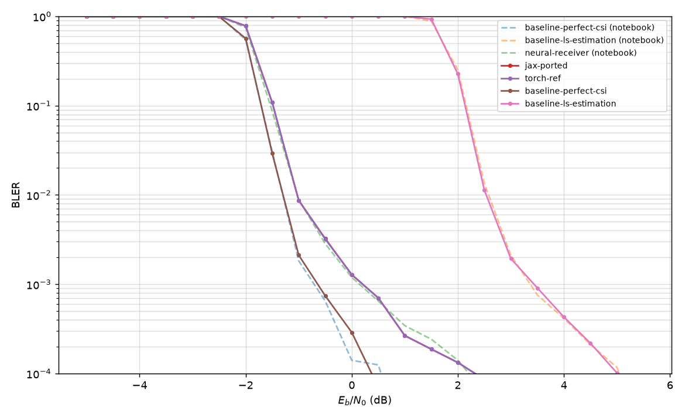

# nrx-jax

Sionna's 5G neural receiver (NRX), ported from PyTorch to JAX/Flax, verified against the original, trained from
scratch, and benchmarked on CPU, Apple GPU, an NVIDIA L4 (XLA and TensorRT) and a TPU v5e.

**Why.** Nvidia runs neural receivers with TensorRT, which only targets Nvidia GPUs. A JAX version compiles through
XLA, so the same receiver can run on GPU, TPU, or any accelerator with a PJRT plugin. The question: can a neural PHY
model meet the 5G slot deadline (0.5 ms at 30 kHz SCS) outside Nvidia's stack? Holding the model, weights and channel
fixed means the compiler stack and the chip are the only things that change.

| | |
|---|---|
| Model | Sionna tutorial NRX: SIMO uplink, 4 residual conv blocks, per-element LayerNorm, 4.86 M params, 4.05 GFLOP per user per slot |
| Channel | 3GPP 38.901 CDL-C, 3.5 GHz, 30 kHz SCS, 128 subcarriers × 14 symbols, QPSK, LDPC rate 1/2 |
| Reference | [`tutorials/phy/Neural_Receiver.ipynb`](https://github.com/NVlabs/sionna/blob/main/tutorials/phy/Neural_Receiver.ipynb), Sionna 2.2.0 |

Details: [PLAN.md](PLAN.md) (spec and acceptance) · [STEPS.md](STEPS.md) (checklist) ·
[CLOUD_SESSION.md](CLOUD_SESSION.md) (log of every cloud run).

---

## Answer

Yes, on a TPU, and not on an L4. One user per slot (B = 1), p99 latency, same weights and inputs everywhere:

| Stack | Precision | p99, B = 1 | p99, B = 128 | Under 0.5 ms? |
|---|---|---|---|---|
| **XLA:TPU v5e** | bf16 (default) | **0.38–0.40 ms** | **9.0 ms** | **yes** |
| TensorRT 11.5, L4 | fp32 | 0.547 ms | 62.7 ms | no, by 0.05 ms |
| XLA:TPU v5e | fp32 (`highest`) | 0.56–0.64 ms | 24.6 ms | no |
| XLA:GPU, L4 | TF32 (default) | 0.869 ms | 44.2 ms | no |
| XLA:GPU, L4 | fp32 (`highest`) | 0.867 ms | 67.9 ms | no |
| Metal (`jax-metal`), M4 Pro | fp32 | 1.34 ms | 86.4 ms | no |
| XLA:CPU, M4 Pro | fp32 | 3.17 ms | | no |

Ranges are two separate Colab sessions. bf16 moves the LLRs by ~0.2 but **leaves the BLER unchanged** (below), so the
TPU's 0.38 ms is a usable number, not a precision shortcut.

What decides it:
- **Per-call overhead, not compute, dominates at B = 1.** The network's math takes ~0.14 ms on the TPU; a trivial
  jitted call already costs ~0.2 ms there and ~0.085 ms on the L4. TensorRT's advantage over XLA on the same GPU
  (0.55 vs 0.87 ms) is almost all at small batch: by B = 8 they are even, and at B = 128 XLA in TF32 is 17% faster.
- **Precision is a hidden variable.** "fp32" is IEEE on CPU, TF32 by default on Ampere/Ada GPUs, and bf16 passes on
  TPU. Every number above states its mode; a comparison that doesn't is comparing different arithmetic.
- **Correctness had to come first.** The pre-trained weights silently depend on pilot symbols that aren't in the
  checkpoint (below). Without recovering them, every backend would have run fast and decoded nothing.

---

## Results

### 1. The port matches PyTorch
With Sionna's pre-trained weights, JAX and torch LLRs agree to **4.96e-5** (max |LLR| ≈ 43) on CPU; both are ~3e-5
from an fp64 reference. Weights are converted OIHW → HWIO for the convs and [C,T,F] → [T,F,C] for the LayerNorms.

### 2. The port matches the published error rate
Full Monte-Carlo sweep with the notebook's settings (Colab L4): JAX and torch are identical at every point, and sit
within 0.00 / 0.07 / 0.12 dB of the notebook at BLER 1e-2 / 1e-3 / 1e-4 (−1.03 / 0.21 / 2.33 dB vs
−1.03 / 0.14 / 2.21 dB). At 1e-4 each point rests on ~13 block errors, so that last gap carries ~±0.15 dB of noise.



### 3. Training from scratch in JAX reproduces the receiver
30k Adam steps at B = 128 on the L4: 158 ms/step, Sionna's data generation fully hidden behind the step, one trace.
The JAX-trained model reaches BLER 1e-2 / 1e-3 / 1e-4 at −1.01 / 0.23 / 2.43 dB against the notebook's
−1.03 / 0.14 / 2.21 dB, **within 0.22 dB** ([results/ber_bler_trained.png](results/ber_bler_trained.png)).

### 4. XLA vs TensorRT on the same GPU (NVIDIA L4)
Same ONNX-exported weights, same fixtures, p99:

| B | TensorRT fp32 | XLA fp32 (`highest`) | TensorRT TF32 | XLA TF32 (default) |
|---|---|---|---|---|
| 1 | **0.547 ms** | 0.867 ms | 0.553 ms | 0.869 ms |
| 8 | 2.99 ms | 3.01 ms | **1.85 ms** | 2.07 ms |
| 128 | 62.7 ms | 67.9 ms | 53.3 ms | **44.2 ms** |

- At B = 1 both stacks pick fp32-accurate conv kernels even when TF32 is allowed (LLR error ~2e-5 either way); TF32
  only pays from B = 8 up, at ~1e-2 LLR error.
- Where XLA's B = 1 time goes, by ablation inside the compiled graph: the 8 residual convs ≈ 58%, the 8 LayerNorms
  ≈ 11%, per-call dispatch ≈ 11% (0.085 ms), the input/output convs plus glue ≈ 0.22 ms
  ([results/compiler_gpu_b1.md](results/compiler_gpu_b1.md)). XLA:GPU emits 70 top-level ops; each conv is a cuDNN
  `convBiasActivationForward` call with the bias fused.
- TensorRT 11 dropped the FP16 builder flag (strongly-typed networks only), so fp16 needs an fp16 ONNX graph and
  isn't measured. Data: `results/{backend,trt}_latency.jsonl`.

### 5. TPU v5e
Same code and fixtures on a Colab v5e-1, p99 (session 5):

| B | bf16 (default) | bf16×3 (`high`) | fp32 (`highest`) |
|---|---|---|---|
| 1 | **0.396 ms** | 0.541 ms | 0.559 ms |
| 8 | 0.584 ms | 1.11 ms | 1.79 ms |
| 128 | **9.04 ms** | 14.1 ms | 24.6 ms |
| max \|ΔLLR\| vs torch | 0.21–0.25 | 8e-4–1.5e-3 | 3e-5–1.3e-3 |

- **bf16 costs no BLER.** A reduced sweep on the TPU with identical channel draws gives −1.04 / −0.01 dB at BLER
  1e-2 / 1e-3 in bf16 and −1.03 / −0.01 dB in fp32, equal at every point within Monte-Carlo noise
  ([bf16](results/ber_bler_tpu_bf16_reduced.csv), [fp32](results/ber_bler_tpu_fp32_reduced.csv); resolution
  ~1e-3, 5,120 blocks per point).
- At fp32-level accuracy the TPU roughly ties TensorRT at B = 1 (0.56–0.64 vs 0.55 ms) and is 2.5× faster at
  B = 128 (24.6 vs 62.7 ms).
- B = 1 is overhead-bound: ~0.2 ms of the ~0.31–0.34 ms median is the fixed cost of a call.
- XLA:TPU compiles the graph differently from XLA:GPU. It fuses each conv with the next LayerNorm's mean/variance
  reduction (10 `kOutput` fusions), prefetches weights into on-chip memory (`copy-start`/`copy-done`), keeps
  activations in bf16 and LayerNorm statistics in fp32, and splits the complex input with `X64SplitHigh/Low` custom
  calls. At B = 1 the graph has 113 top-level ops, many `pad`/`slice`/`copy` re-tiling the subcarrier axis because
  one user can't fill the TPU's tiles; at B = 128 it has 40. The pipeline runs 604 passes (75 distinct, 42
  pipelines) against 202 on CPU and 563 on GPU ([results/compiler_tpu_b1.md](results/compiler_tpu_b1.md)).
- The ablation breakdown doesn't hold on the TPU at B = 128: removing the residual convs made the graph *slower*
  (11.7 vs 8.9 ms), because XLA re-tiles and re-fuses the reduced graph. Ablation only measures a part's cost when
  the rest compiles the same way.
- Training runs at 24 ms/step on the TPU (bf16) vs 158 ms on the L4, but Sionna generates batches on the host CPU at
  ~36 ms each, so the TPU waits ~12 ms per step. Feeding it needs the channel model on the accelerator too.

### 6. Inside the compiler (XLA:CPU, B = 1)
186 jaxpr equations become 305 StableHLO ops and then 62 top-level ops. Convs take ~75% of the time and LayerNorm
~20%. Each LayerNorm becomes 5 ops, and the conv bias add isn't fused into the conv (unlike XLA:GPU). The full pass
sequence is in [results/compiler_cpu_b1.md](results/compiler_cpu_b1.md); optimized HLO for every backend and
precision is under [results/hlo/](results/hlo/).

### Finding: the pilots are part of the model
Sionna 2.x draws the Kronecker pilot symbols from the active device's torch RNG when the resource grid is built.
The tutorial weights were trained on CUDA with seed 42, and the pilots are **not** stored in the checkpoint.
On any other device the pilots differ, and the pre-trained receiver fails completely (uncoded BER ≈ 0.44). The
network-level parity test can't catch this, because both models get the same wrong pilots.

[`nrx/pilots.py`](nrx/pilots.py) recovers them from the weights. The received grid is linear in the pilots, so it
maximizes the receiver's BMD rate over the 232 pilot values with JAX gradients and snaps the result to QPSK. The
result matches all 232 pilots regenerated from the CUDA RNG on an L4. Both sets are checked in
([`assets/`](assets/)), and the CUDA set is applied automatically.

---

## Reproduce

### Requirements
- [uv](https://docs.astral.sh/uv/getting-started/installation/) (it installs Python 3.12 itself)
- macOS (arm64) or Linux x86-64; ~3 GB disk for the venv
- Optional: an NVIDIA GPU (CUDA 13 driver) or a TPU, for training, full sweeps, and the latency numbers above

### Laptop (CPU), about 2 minutes
```bash
git clone https://github.com/kredd2506/hyouka.git && cd hyouka
make setup          # uv sync: exact pinned versions from uv.lock
make test           # downloads + checksums the weights, runs 11 tests (~5 s)
make all-local      # backends + compiler walk + ONNX export (~80 s)
```
Run `make help` for every target. Each one is a single `uv run python …` command, so you can also run them by hand.

| Target | What it does | Time (M4 Pro CPU) |
|---|---|---|
| `make weights` | Downloads Sionna's pre-trained weights (Google Drive, 19 MB) and verifies sha256 | seconds |
| `make test` | Shapes, LayerNorm parity, data-RE gather vs Sionna, weight-port parity, pilots, one-trace train step | ~5 s |
| `make backends` | Compile + p50/p99 latency + LLR parity for B ∈ {1, 8, 128} (`PRECISION=default\|high\|highest`) | ~1 min |
| `make compiler` | jaxpr → StableHLO → HLO walk, ablation time breakdown, XLA pass dump to `data/xla_dump/` | ~2 min |
| `make onnx` | Exports the torch NRX to ONNX (real-valued inputs) and checks it with onnxruntime | ~1 min |
| `make sweep-reduced` | BLER sweep, 40 MC iterations, 4 systems | ~30 min |
| `make pilots-recover` | Re-derives the training pilots from the weights | ~2 min |

### Colab (GPU or TPU), no setup
Open [`notebooks/nrx_colab.ipynb`](notebooks/nrx_colab.ipynb) in Colab
([direct link](https://colab.research.google.com/github/kredd2506/hyouka/blob/main/notebooks/nrx_colab.ipynb)),
pick an **L4/A100 GPU** or a **v5e-1/v6e-1 TPU** runtime, and use *Runtime → Run all*. The notebook detects the
accelerator, installs the matching build, stops early if JAX isn't on that device, runs the sections that apply,
keeps checkpoints on Google Drive, and ends with a summary table and a results zip. If the runtime restarts, use
*Run all* again; training resumes from its last checkpoint.

### GPU host (CUDA)
```bash
make setup EXTRA=cuda
make all-cloud       # test, exact pilots, backends, compiler, ONNX, full sweep, 30k-step training, trained sweep
```
TensorRT comparison on the same GPU:
```bash
make trt-install                                       # TRT_CUDA=cu12 on drivers < 580
make trt                                               # ONNX export + TensorRT fp32 / tf32
make backends PRECISION=highest && make backends       # XLA fp32 and TF32
```
Notes:
- The Makefile sets `XLA_PYTHON_CLIENT_PREALLOCATE=false`. Otherwise JAX reserves 75% of GPU memory and Sionna's
  torch (which generates the channel on the same GPU) runs out.
- Training resumes from the latest checkpoint in `RUN` (default `checkpoints/run1`). Change length with
  `make train STEPS=5000`.

### TPU
TensorRT, the exact-pilot step and the full sweeps need a GPU. On a TPU the useful runs are latency and the compiler
walk in three precisions, a reduced BLER sweep per precision, and a short training run:

| `PRECISION` | What XLA:TPU does for f32 convs | Compare with |
|---|---|---|
| `default` | one bf16 pass (fastest; ~0.2 LLR error, no BLER cost here) | GPU TF32 |
| `high` | bf16×3, close to fp32 | |
| `highest` | full fp32 emulation (~6 bf16 passes) | GPU fp32 |

On Colab, pick a TPU runtime and *Run all* (see above). On a Cloud TPU VM:
```bash
gcloud compute tpus tpu-vm create nrx --zone=us-central1-a \
    --accelerator-type=v5litepod-1 --version=v2-alpha-tpuv5-lite
gcloud compute tpus tpu-vm ssh nrx --zone=us-central1-a
# on the VM:
curl -LsSf https://astral.sh/uv/install.sh | sh && source ~/.local/bin/env
git clone https://github.com/kredd2506/hyouka.git && cd hyouka
make setup EXTRA=tpu
make host-info test
for p in default high highest; do make backends compiler PRECISION=$p; done
for p in default highest; do JAX_DEFAULT_MATMUL_PRECISION=$p uv run python -m nrx.evaluate \
    --systems jax-ported --max-mc-iter 40 --out results/ber_bler_tpu_$p.csv; done
make train RUN=checkpoints/run_tpu STEPS=300     # Sionna runs on the host CPU: compare wait_ms with step_ms
```
Delete the VM afterwards (`gcloud compute tpus tpu-vm delete nrx --zone=us-central1-a`), since it bills while it
exists. Pilots come from `assets/`, so the pre-trained weights work on a TPU host even though its torch RNG differs.

### Apple GPU (Metal), optional
`jax-metal` was last released for jax 0.4.34 and can't load into this project's env, so it gets a separate venv:
```bash
make fixtures                                    # in the main env
uv venv -p 3.12 .venv-metal
VIRTUAL_ENV=.venv-metal uv pip install "jax==0.4.34" "jaxlib==0.4.34" "jax-metal==0.1.1" "flax==0.10.0" numpy
.venv-metal/bin/python bench/backends.py --real-input --no-dump-hlo
```
Metal rejects `complex64` inputs, so `--real-input` splits Re/Im on the host.

### Determinism
- Versions: `uv.lock` pins everything. `make setup` installs exactly those versions.
- Weights: sha256-checked (`nrx/config.py`).
- Pilots: checked in. Set `NRX_PILOTS=path.npy` to use another set.
- Monte-Carlo: `sionna.phy.config.seed` is reset per system, so every receiver sees the same channel draws.
  Results still vary with device (CPU vs CUDA RNG) and with batch size.
- Tolerances: the parity tests pin `highest` precision and name the backend where it matters (TPU emulates fp32 with
  bf16 passes, and its `log10` is approximate to ~3e-5).

---

## Layout
```
nrx/
  config.py         system parameters (from the notebook) and paths
  data.py           Sionna transmitter + CDL channel -> JAX arrays; static data-RE gather
  model.py          Flax NRX (NHWC) and GridLayerNorm
  torch_ref.py      the notebook's torch NRX, verbatim, for parity
  port_weights.py   torch state_dict -> Flax params (OIHW->HWIO, LN [C,T,F]->[T,F,C])
  pilots.py         recover / regenerate / compare training pilots
  loss.py           BMD rate
  train.py          jitted train step, Optax Adam, Orbax checkpoints, prefetch thread, single-trace assert
  evaluate.py       BER/BLER sweeps through Sionna's LDPC decoder; plots vs the notebook
  fetch_weights.py  download + checksum
bench/
  backends.py       latency + parity on any XLA backend, per precision
  inspect_compiler.py  compiler-stack walk, ablation time breakdown, pass dump
  export_onnx.py    ONNX export for TensorRT
  trt_bench.py      TensorRT engines (fp32 / TF32) timed like backends.py
notebooks/
  nrx_colab.ipynb   one-click Colab run on GPU or TPU
tests/              pytest suite (make test)
assets/             training pilots (recovered and CUDA-exact)
results/            reference.csv (from the notebook), sweeps, latency, compiler reports, HLO per backend
```
Generated and ignored: `weights/`, `data/` (fixtures, XLA dumps), `checkpoints/`, `results/onnx/`.

## Status
- [x] Port + weight parity (< 1e-4)
- [x] Full BLER sweep to 1e-4 (L4): 0.12 dB from the notebook
- [x] JAX-trained model within 0.5 dB of reference at BLER 1e-4 (L4: 0.22 dB); train step compiles once
- [x] XLA vs TensorRT on the same GPU (L4, fp32 and TF32)
- [x] XLA:TPU v5e latency in bf16 / bf16×3 / fp32; bf16 costs no measurable BLER
- [x] Compiler reports and pass dumps for CPU, GPU and TPU
- [ ] TensorRT fp16 (needs an fp16 ONNX graph)
- [ ] TPU bf16 BLER at 1e-4 (the reduced sweep resolves ~1e-3)

## Credits
Model, system setup and pre-trained weights come from NVIDIA's [Sionna](https://github.com/NVlabs/sionna)
neural receiver tutorial. This repo reimplements the receiver in JAX for compiler and latency research.
